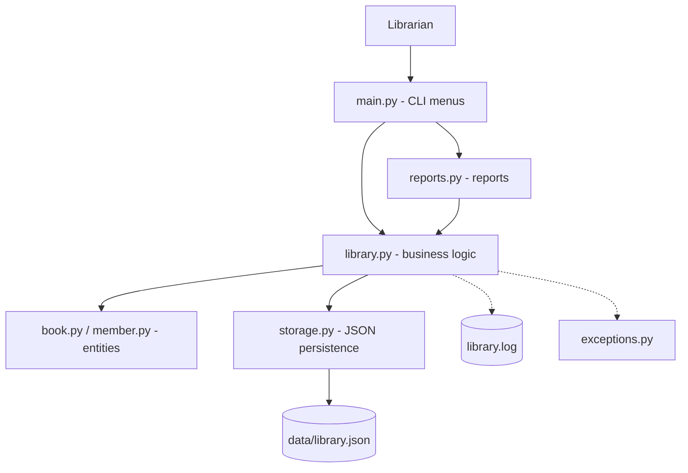
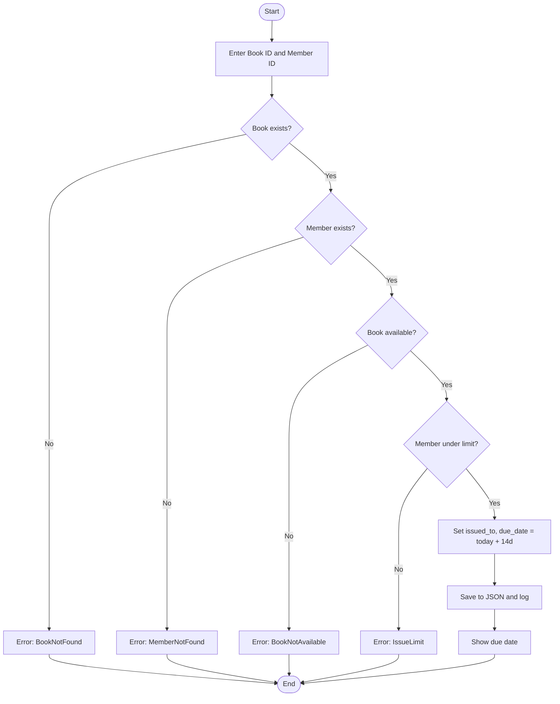
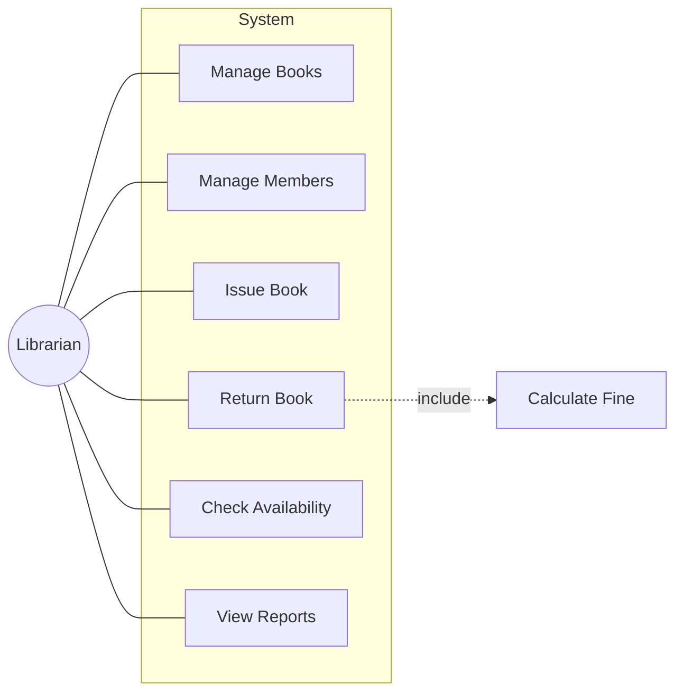
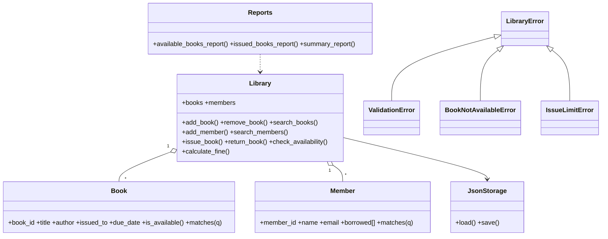
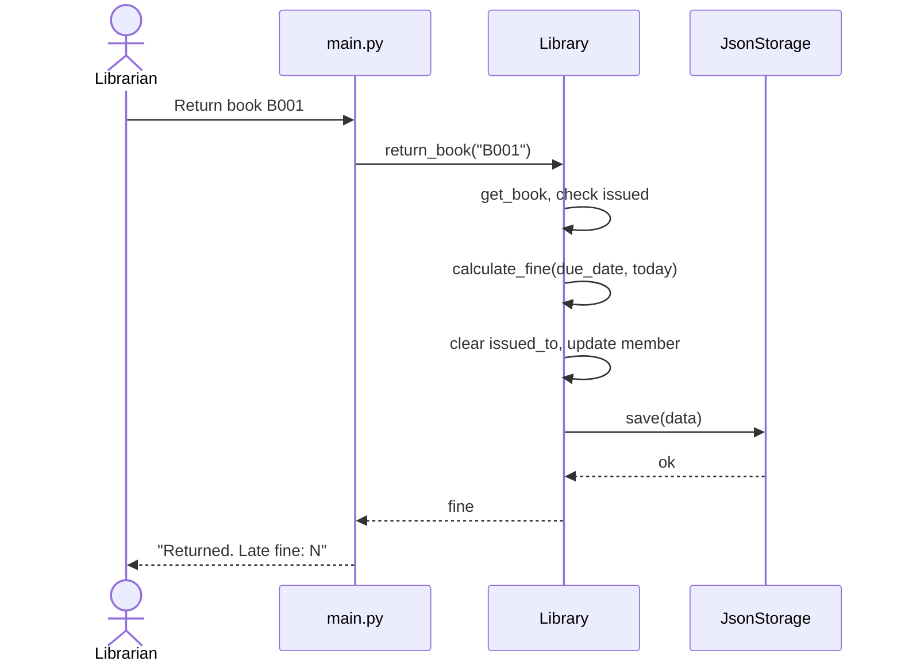
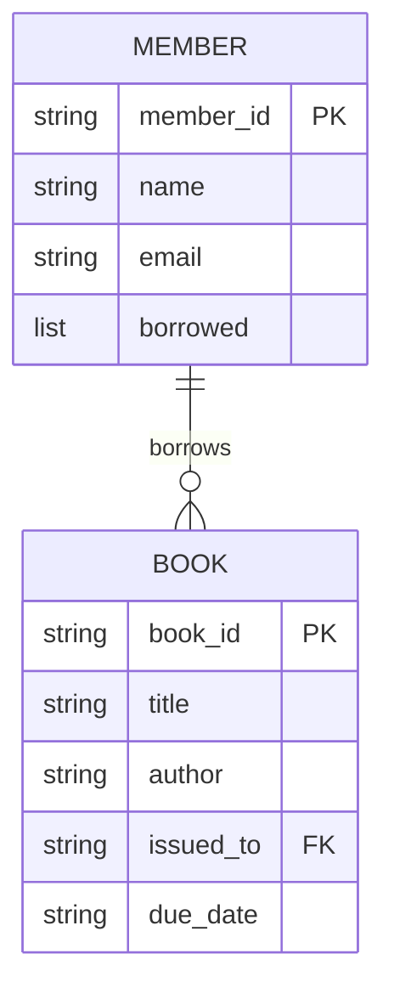

# Design Document

## 1. Functional Requirements
| Module | Requirements |
|---|---|
| Book Management | FR1 add book, FR2 view all, FR3 search, FR4 remove |
| Member Management | FR5 add member, FR6 view members, FR7 search member |
| Issue & Return | FR8 issue, FR9 return (+fine), FR10 check availability |
| Reports | FR11 available books, FR12 issued books, FR13 summary |

## 2. Non-Functional Requirements
1. **Reliability** - atomic file writes; corrupt data file reported cleanly, never overwritten silently.
2. **Usability** - numbered menus, clear error messages, case-insensitive IDs and search.
3. **Maintainability** - layered modules, one responsibility each, type hints, docstrings.
4. **Error handling** - custom exception hierarchy; unexpected errors caught and logged, app stays alive.
5. **Logging** - every state change written to `library.log`.
6. **Testability** - business logic has no I/O; date is injectable; 16 unit tests.

## 3. System Architecture

## 4. Workflow: Issue a Book

## 5. Use Case Diagram

## 6. Class Diagram

## 7. Sequence Diagram: Return a Book

## 8. Storage Design (JSON schema)

## 9. Design Decisions & Rationale
- **Layered structure** keeps UI, logic and storage independently testable/replaceable.
- **JSON storage** - zero dependencies, human-readable; `JsonStorage` can be swapped for SQLite.
- **Custom exceptions** let the UI show precise messages without parsing strings.
- **Injectable `today`** makes date-dependent rules (fines, overdue) deterministic in tests.
- **Atomic writes** (temp file + `os.replace`) prevent half-written data files.
